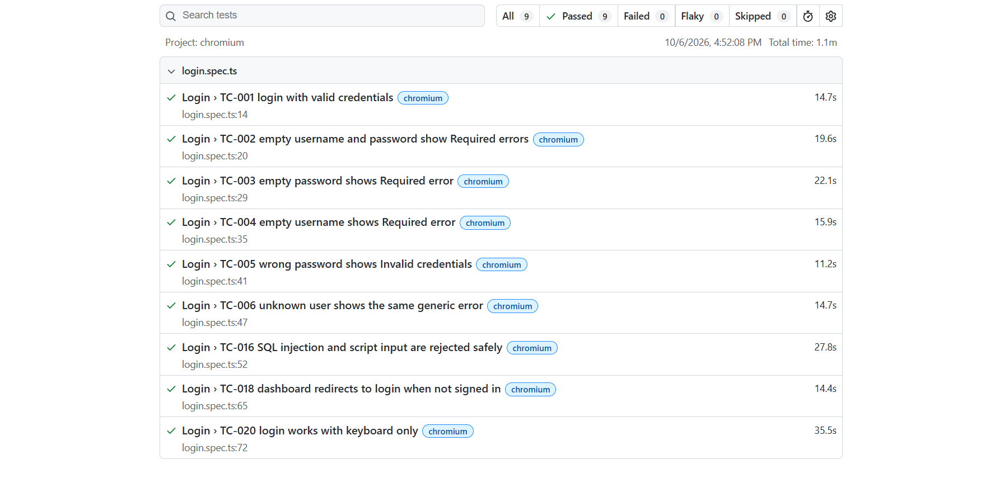
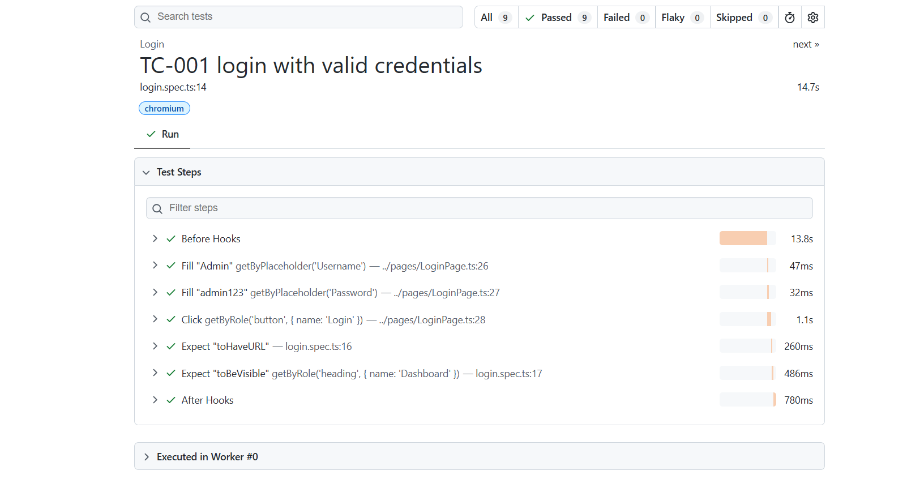
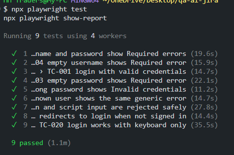
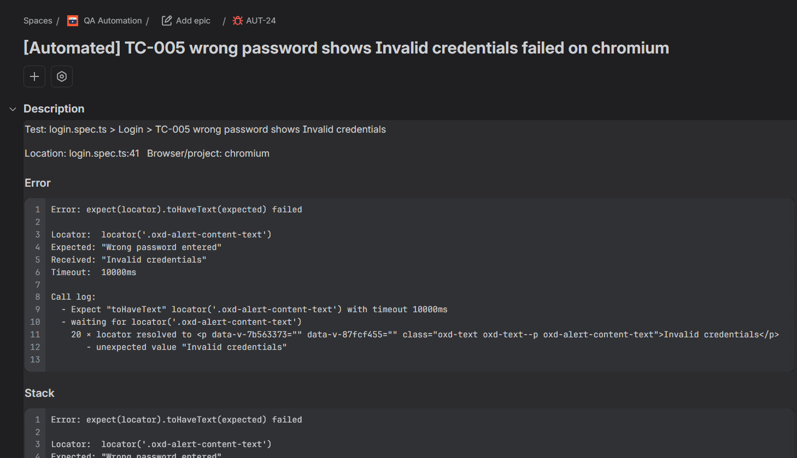
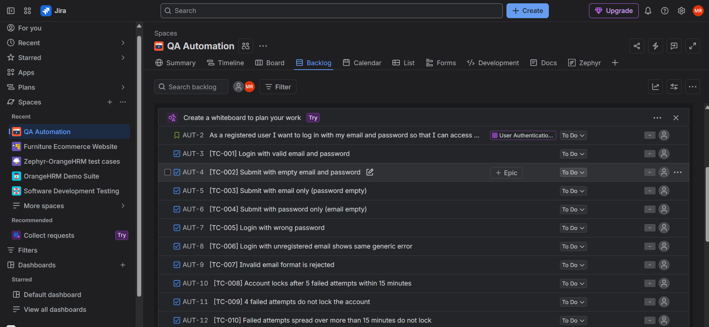
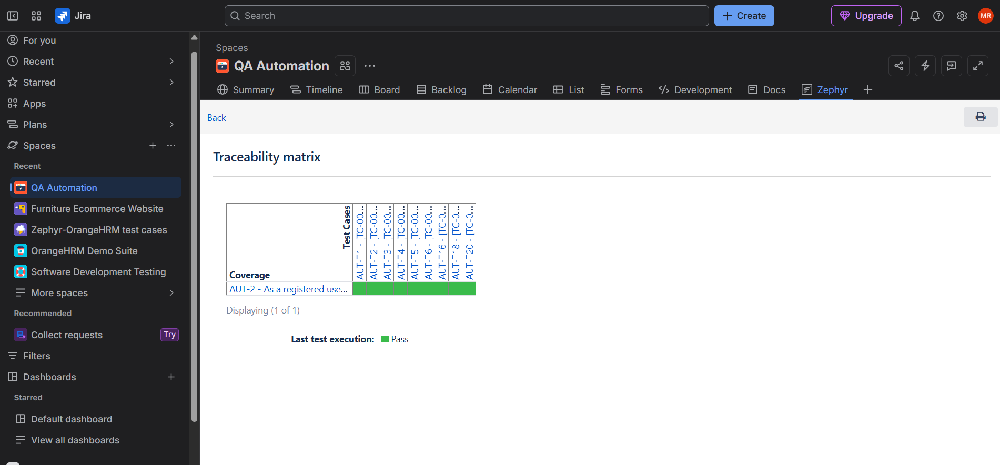
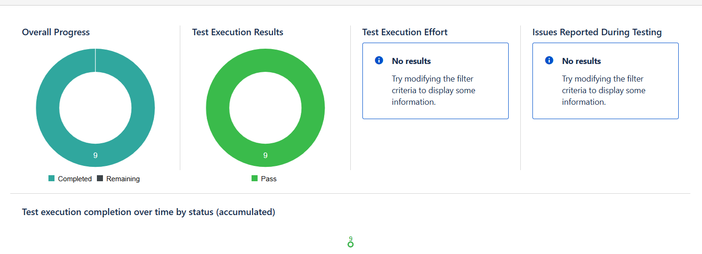
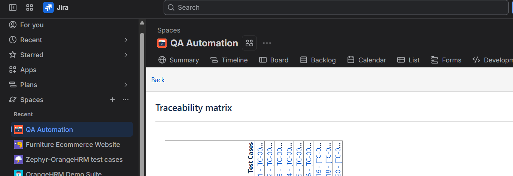
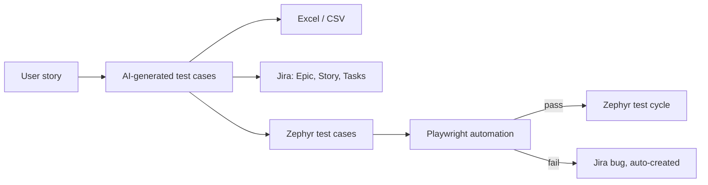

# AI-Assisted QA Automation Pipeline

An end-to-end QA workflow that takes a user story all the way to automated tests, test management and defect tracking, using **AI, Python, Jira, Zephyr and Playwright**.










## What this project does



1. **Test design with AI:** generated 21 test cases (positive, negative, edge, security, accessibility) from a login user story.
2. **Export:** test cases saved to Excel and CSV.
3. **Jira integration (REST API, Python):** Epic, Story and test-case issues created automatically and linked together.
4. **Zephyr test management:** 21 test cases imported with step-by-step scripts, linked to the Jira Story for traceability.
5. **Playwright automation (TypeScript, Page Object Model):** 9 test cases automated against the OrangeHRM demo site.
6. **Defect tracking:** failed tests automatically create a Jira Bug with the error, stack trace, screenshot and a link to the test case. Repeat failures add a comment instead of a duplicate bug.
7. **Execution reporting:** results recorded in a Zephyr test cycle (100% pass).

## Tech stack

| Area | Tools |
|---|---|
| Test automation | Playwright, TypeScript, Page Object Model |
| Scripting / integration | Python, Jira REST API v3, Zephyr API |
| Test management | Jira, Zephyr (SmartBear) |
| AI | Claude, for test case generation |
| Reporting | Playwright HTML/JSON reports, Zephyr reports, Excel |

## Test coverage

| ID | Test case | Type | Automated |
|---|---|---|---|
| TC-001 | Login with valid credentials | Positive | ✅ |
| TC-002 | Empty username and password | Negative | ✅ |
| TC-003 | Empty password | Negative | ✅ |
| TC-004 | Empty username | Negative | ✅ |
| TC-005 | Wrong password shows generic error | Negative | ✅ |
| TC-006 | Unknown user shows same generic error | Security | ✅ |
| TC-016 | SQL injection and XSS input rejected | Security | ✅ |
| TC-018 | Dashboard blocked when not logged in | Security | ✅ |
| TC-020 | Login works with keyboard only | Accessibility | ✅ |
| TC-007 to TC-021 (others) | Lockout, Remember Me, show/hide password, screen reader, etc. | Mixed | Manual (features not on demo site) |

## Project structure

```
qa-ai-jira/
├── qa_pipeline.py        # Excel/CSV export, Jira issue creation, auto bug reporting
├── zephyr_sync.py        # Zephyr test cases and test cycle results via API
├── make_zephyr_csv.py    # Zephyr CSV import file
├── check_jira.py         # Jira connection check
├── pages/LoginPage.ts    # Page Object
├── tests/login.spec.ts   # Playwright tests
├── playwright.config.ts
├── out/login.json        # Test cases (source of truth)
└── screenshots/
```

## How to run

```bash
# Python setup
pip install -r requirements.txt
cp .env.example .env          # then add your own Jira details

# Create Excel/CSV and push test cases to Jira
python qa_pipeline.py push out/login.json --dry-run
python qa_pipeline.py push out/login.json

# Playwright
npm install
npx playwright install
npx playwright test
npx playwright show-report

# Create Jira bugs for any failed tests
python qa_pipeline.py bugs reports/results.json --cases out/login.json
```

## Screenshots

**Test cases in Excel**


**Jira: Epic and Story**


**Automatically created Jira bug from a failed test**


**Zephyr: test cases with step-by-step scripts**


**Zephyr: test cycle and execution report**


**Playwright test detail**


## What I learned

- Designing test cases across positive, negative, edge, security and accessibility scenarios
- Working with REST APIs (authentication, JSON payloads, Atlassian Document Format)
- Writing maintainable Playwright tests with the Page Object Model and user-facing locators
- Requirement-to-test traceability in Zephyr
- Automating defect reporting while preventing duplicate bugs
- Troubleshooting real integration issues, and choosing a CSV import fallback when an API was unavailable

## Author

**Mahnoor Rizwan**, SQA Engineer